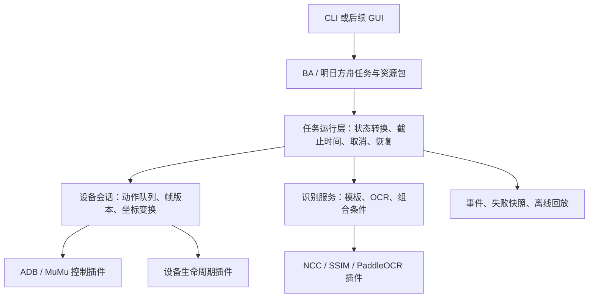

OpenAR 重构计划（已批准；保留原始审阅记录）

日期：2026-10-06。审阅优先级：稳定性与架构可维护性。

本文主体保留初次静态审阅结论和历史行号。用户已批准实施，并澄清范围为所有简单界面的安卓脚本，游戏仅作举例。当前设计、构建和实测状态见 docs/ARCHITECTURE.md、docs/VALIDATION.md，下文“未测试”等表述属于历史记录。

建议采用渐进重构：保留 C++20、现有 NCC/SSIM/PaddleOCR 算法、ADB/MuMu 后端和 C ABI 插件方式，先修复可靠性缺陷，再形成完整的自动化运行层。目标是让游戏开发者描述“当前状态、执行动作、预期状态”，由框架统一管理截图、识别、取消、超时、重试和诊断。

当前副本包含 63 个自研 C++/CUDA 源码及头文件，约 6,477 行，解决方案包含 11 个实际工程。工程引用的源码路径静态检查未发现缺失。未发现独立测试工程或 CI 配置，当前目录也没有 Git 元数据。README 中引用的旧重构计划此前未包含在该副本中；本文件是新的审阅提案。

实施阶段已阅读用户提供的 BAAH 源码和 MaaFramework 设计。交付范围按用户澄清为通用框架、真实安卓设置导航和离线回放，具体游戏通过独立资源包接入，不承诺外部 JSON/API 兼容或完整游戏业务。

**应保留的基础已经存在。** `IImageMatcher`、`IOcrEngine`、`IController`、`IDeviceController` 的划分有价值；纯 C ABI 避免 C++ 类型跨 DLL 边界的方向合理；PaddleOCR 的 CPU/GPU 实现也已经共享主要逻辑。重构应围绕实际缺口展开，并用兼容适配器保护现有调用方。

**优先修复的问题有明确代码依据。** 下表中的风险是静态分析结论，尚未通过故障注入动态复现。P0 表示优先处理可能挂死或发生非法内存访问的路径；P1 表示随后处理错误传播、配置和运行可靠性。

| 优先级 | 代码依据 | 当前行为与影响 | 建议处理 |
|---|---|---|---|
| P0 | [Cmd.hpp:84](D:/OpenAR-main/ar/include/core/Cmd.hpp:84) | 先阻塞 `ReadFile`，后执行带超时的等待；子进程保持管道打开时，配置的超时不能覆盖输出读取阶段 | 整个进程执行共用截止时间；输出读取可中断；超时或取消后收回进程、管道和读取线程 |
| P0 | [PluginLoader.cpp:344](D:/OpenAR-main/ar/src/plugin/PluginLoader.cpp:344) | 注册 matcher/controller/device 时只验证部分导出，适配器却直接调用其他函数；不完整插件可能进入空函数指针调用路径 | 按族完整校验必需函数；可选能力单独声明并检查；输出具体缺失项 |
| P0 | [NccCpu.cpp:92](D:/OpenAR-main/plugins/matcher/ncc_cpu/NccCpu.cpp:92)、[NccPipeline.cu:278](D:/OpenAR-main/plugins/matcher/ncc_cuda/NccPipeline.cu:278)、[SsimPipeline.cu:288](D:/OpenAR-main/plugins/matcher/ssim_cuda/SsimPipeline.cu:288) | 从模板起始地址连续哈希 `step * rows`；带横向偏移且延伸到父图末行的 ROI 可能越界，其他非连续模板也会把无关像素或填充计入哈希；CPU NCC 缓存键还缺少尺寸/通道 | 按行只读取有效像素；缓存键包含模板身份/版本、几何、格式和预处理参数 |
| P1 | [Cmd.hpp:71](D:/OpenAR-main/ar/include/core/Cmd.hpp:71)、[Cmd.hpp:93](D:/OpenAR-main/ar/include/core/Cmd.hpp:93) | stderr 合并进 stdout，退出码被读取后丢弃；ADB 二进制截图可能混入诊断文本，调用方主要靠字符串猜测错误 | 分开输出流，保留退出码、系统错误、耗时与终止原因 |
| P1 | [PluginLoader.cpp:100](D:/OpenAR-main/ar/src/plugin/PluginLoader.cpp:100)、[OrtSession.hpp:72](D:/OpenAR-main/plugins/ocr/paddle_common/OrtSession.hpp:72) | 适配器对象非空不代表插件句柄创建成功；模型加载失败也可能留下不可用的 OCR 对象 | 工厂仅返回完成初始化的对象；区分未知后端、依赖缺失、模型错误和设备连接失败 |
| P1 | [PluginLoader.cpp:297](D:/OpenAR-main/ar/src/plugin/PluginLoader.cpp:297)、[PluginExports.cpp:95](D:/OpenAR-main/plugins/ocr/paddle_cpu/PluginExports.cpp:95) | OCR 有文本时，查询数量和获取结果各执行一次完整推理；第二次返回状态及数量上界没有完整校验 | 推理一次生成结果句柄，再读取并释放；v1 过渡期先修复状态和容量检查 |
| P1 | [Matcher.h:25](D:/OpenAR-main/ar/include/vision/Matcher.h:25)、[PluginLoader.cpp:100](D:/OpenAR-main/ar/src/plugin/PluginLoader.cpp:100)、[Ocr.h:28](D:/OpenAR-main/ar/include/vision/Ocr.h:28)、[PluginApi.h:119](D:/OpenAR-main/ar/include/plugin/PluginApi.h:119) | matcher 的 `max_input_bytes` 没有传入 DLL，OCR 的 `det_line_merge_ratio` 未进入 C ABI；公共配置与实际行为不一致 | 建立字段映射表，补齐配置传递；增加端到端配置契约测试 |
| P1 | [控制器 PluginExports.cpp:30](D:/OpenAR-main/plugins/control/adb/PluginExports.cpp:30)、[PluginLoader.cpp:153](D:/OpenAR-main/ar/src/plugin/PluginLoader.cpp:153) | 控制器插件丢弃日志回调；路径以窄字符串转换，UTF-8 与 Windows 路径编码约定不完整 | 共用日志桥；ABI 文本统一 UTF-8，进入 Windows 文件 API 前显式转换 |
| P1 | [Plugins.Common.props:6](D:/OpenAR-main/build/Plugins.Common.props:6)、[ARFrameWork.vcxproj:129](D:/OpenAR-main/build/ARFrameWork/ARFrameWork.vcxproj:129)、[main.cpp:71](D:/OpenAR-main/ar/src/app/main.cpp:71) | 构建和复制依赖使用机器路径；默认入口要求 GPU matcher，且同时要求 CPU/GPU OCR | 增加 CPU 构建配置和独立 GPU 配置；按启用模块打包运行库与模型 |
| P1 | [ProxyClient.cpp:21](D:/OpenAR-main/ar/src/net/ProxyClient.cpp:21)、[Http.h:56](D:/OpenAR-main/ar/include/net/Http.h:56) | 代理使用固定目录、固定端口和共享节点选择；通用 HTTPS 请求默认忽略证书错误 | 提取为可选服务，明确共享和独占模式；配置端口、工作目录及所有权；恢复默认证书校验 |

此外，当前 `bool`、空图像、空 OCR 数组和“未匹配”承担了多种失败语义。任务层无法可靠地区分正常等待和底层故障，这是运行恢复策略难以统一的根源。

**目标结构按职责划分。** 先确定依赖方向，再逐步迁移目录；每个模块应有实际职责，不要求每个模块都成为 DLL。



框架核心及后端不得引用游戏包。游戏包通过识别服务和动作接口表达需求；复杂游戏策略使用 C++ 扩展。宿主负责创建服务、选择资源包和启动任务。网络代理作为宿主按需启用的服务，与视觉和任务核心分开构建。

建议最终目录如下。实施过程中保留旧头文件转发和工厂包装，逐个迁移调用点。

```text
include/ar/                 公共 SDK：错误、配置、会话、任务、视觉、插件契约
src/core/                   错误类型、时钟、配置、轻量基础类型
src/platform/windows/       进程、句柄、DLL、路径、WinHTTP 适配
src/plugin/                 加载、能力检查、四族 C++ 适配器
src/device/                 会话、连接状态、帧存储、坐标变换
src/vision/                 识别请求、模板资源、缓存、结果组合
src/runtime/                任务执行、截止时间、取消、恢复、事件
plugins/                    当前算法和控制后端
plugins/common/             日志桥、ABI 校验、CUDA 工具等共用实现
services/proxy/             可选代理服务
games/blue_archive/          BA 流程和复杂策略
games/arknights/             明日方舟流程和复杂策略
resources/<game>/<profile>/  模板、流程定义、语言/区服/分辨率配置
apps/cli/                   用户运行入口
examples/                   原演示程序及 SDK 示例
tests/                      契约测试、故障注入、回放用例
benchmarks/                 独立性能测试
projects/vs/                受版本管理的 VS 工程与公共属性表
scripts/                    构建、依赖检查、打包、验证
out/                        可清理的编译产物
dist/                       可分发的程序与资源包
```

**错误和资源契约先统一。** 在 C++20 下提供轻量 `Result<T>`，暂不提高到 C++23。错误携带类别、操作名、后端名、原始错误码和诊断文本。至少区分参数错误、不支持、设备离线、超时、取消、依赖缺失、模型错误和后端执行失败。

模板未命中表示成功完成识别但没有候选；OCR 无文本表示成功但结果为空；截图失败和推理失败必须返回错误。是否重试由任务上下文及动作语义决定，不能仅根据错误码自动重试。尤其在点击结果不确定时，应重新截图确认状态，避免重复执行同一业务动作。

进程接口接收程序路径和参数数组，返回退出码、分离的输出流、耗时、超时/取消信息，并限制输出大小。Windows HANDLE、HTTP 句柄、截图缓冲区和插件结果使用 RAII。停止任务时须等待受控操作收尾，触摸按下后必须保证释放。

**插件 ABI 分两步升级。** 第一阶段修补现有 v1 的完整导出校验、初始化失败、异常边界、输入步长和结果容量验证。所有 C 导出都将异常转换为状态；日志桥复用，不能让异常越过 C 边界。插件未加载与插件已加载但创建失败分别报告。

第二阶段新增 v2 查询入口及描述符，描述 ABI 版本、结构体大小、后端身份、能力、线程使用约定和函数表。图像描述包含格式、宽高、步长与可读长度；OCR 用一次推理的结果句柄返回可变长 UTF-8 文本。结构体扩展明确大小、对齐和默认值。matcher 配置及 OCR 参数完整传递。

加载器优先使用 v2，并支持现有 v1 导出；新入口与 v1 共存，避免直接改动现有函数签名。v1 无法表达的新能力返回明确的不支持结果。外部消费者迁移完成后再讨论停止 v1 支持。

继续采用启动时加载，运行期不做热卸载。插件注册在启动阶段完成并冻结，运行期只读；注册表拥有名称字符串，输出顺序确定，重复后端冲突有明确处理。实例和工厂显式持有模块生命周期。每个设备会话独立持有有状态后端，暂不并发调用同一 matcher/OCR 实例。

必须明确稳定性边界：C ABI、校验和异常捕获可以减少接入错误，但进程内插件发生访问违例或不可中断的厂商 SDK 调用，仍可能影响宿主。若故障注入或实机验证发现这类问题，再将相应后端放入受监管的工作进程；该能力单独作为后续阶段，避免先承诺无法保证的硬取消。

**设备会话统一管理截图和输入。** 新增 `DeviceSession`，组合截图/输入控制器与设备生命周期管理器，保留两者独立接口。设备标识支持完整 ADB serial，TCP 地址只是其中一种；MuMu 安装路径和实例编号只属于 MuMu 配置。

每个会话拥有串行动作队列、连接状态、独立配置、日志上下文和最新帧。`Frame` 具有帧编号、单调时钟时间、原始尺寸、旋转/视口信息及明确的内存所有权。同一轮多个识别条件共享同一帧；执行动作后使旧帧失效，后置检查必须使用动作完成之后的新帧。

坐标转换由一个模块管理：资源参考坐标 → 有效游戏视口 → 设备输入坐标。支持等比例缩放、偏移、黑边和方向变化；对比例无法适配的资源包明确拒绝或切换配置。当前 matcher 的“长边缩到 640”是计算缩放，不能自动解决不同设备上的 UI 模板尺度差异。

控制连接不等于设备或游戏已经就绪。启动模拟器、建立控制通道、启动应用及识别稳定画面使用独立的有界等待。发生连接故障后重新验证连接和画面，而非永久相信缓存的 `connected_` 状态。

**视觉服务统一请求和资源，保留算法语义。** 每次识别返回帧编号、候选位置、算法类型和原始分数。NCC、SSIM 与 OCR 的分数、阈值保持各自定义，不伪装成同一种概率。配置指定算法和阈值，验证数值范围、ROI、图像格式、模板尺寸和退化模板。

模板由资源管理器加载为只读对象，带稳定 ID 和版本；预处理缓存以资源版本、缩放及算法配置为键。保留安全的任意 `cv::Mat` 路径，按行处理非连续图像。公共图像校验和缩放/坐标映射规则共享；NCC 与 SSIM 的评分实现继续各自维护。将 NCC 使用的 `ssim_cuda/CudaImageOps` 移入公共 CUDA 工具目录，解除后端之间的目录依赖。

CPU/GPU 的选择遵循明确策略：指定后端时创建失败即报告；选择自动模式时才允许按配置降级，并记录原因。NCC CUDA 与 CPU 的替换需经结果一致性验证；不能因 GPU 不可用而自动将 NCC 改成 SSIM。OCR 查询可先识别一次，再在相同结果上执行精确、包含或正则匹配。

先按游戏资源选择 ROI 和识别频率，并记录“截图 → 识别 → 动作 → 画面确认”的整体耗时，再判断是否需要进一步 CUDA 优化。现有 README 性能数字不作为本轮实测结果，也不能代替完整任务的吞吐指标。

**任务运行层从有限状态流程开始。** 提供识别条件、动作、成功后继、异常后继、节点截止时间、轮询间隔、次数上限与恢复入口。简单任务使用 JSON，复杂逻辑通过 C++ 自定义识别器和动作扩展。首版避免引入完整脚本语言、协程调度器或行为树系统。

任务流程应表达“识别目标 → 执行动作 → 等待预期状态”。节点有超时，整个任务也有总截止时间和转换次数上限，确保循环无法无限运行。固定短等待可以用于必要的界面节流，但状态确认以新画面为准。

恢复策略必须有顺序和预算，例如重新截图、重新连接、返回已知页面、重新启动应用；每一步均重新验证状态。应用重启、模拟器重启等策略由游戏包和用户配置启用，不能在错误处理里无界触发。进程重启后的任务恢复通过重新识别稳定状态完成；仅记录上一个节点不足以可靠续跑。

同一设备按顺序执行任务，不同设备可独立运行，GPU 任务设并发上限。首版支持取消，等待和子进程执行可及时响应；厂商 SDK 调用的最长阻塞时间在验收中单独列出。暂停/继续、跨进程恢复和动态热更新不进入首版必需范围。

**游戏资源与任务配置有版本和校验。** 配置分为设备配置、运行配置、用户任务参数和游戏资源包。资源包包含清单、流程、模板、参考尺寸、语言/区服及模型引用；模型可以共用，避免每个游戏重复分发。

资源加载时检查 Schema、引用节点、模板文件、模型与字典、参数范围、重复名称及协议版本，并报告定位到文件和字段的错误。允许有界循环，对不可达节点和缺少退出预算的循环给出诊断。任务启动时取得不可变资源快照；更新资源在后续任务启动时生效。

游戏任务只引用模板和识别条件 ID，模板路径、ROI、阈值与区域差异由资源包承担。BA 和明日方舟业务策略分别维护。接入试点先验证“识别页面、完成一次导航、确认目标页面”的完整流程，再逐步加入日常任务；账号、游戏客户端版本与操作范围需在试点实施前明确。

**构建保持 MSBuild，先解决可重复性。** 保留 VS2022/v143 和 C++20。公共属性表集中管理依赖路径；路径通过环境或本机未提交的配置提供，脚本使用 `$PSScriptRoot` 推导位置。工程定义迁到 `projects/vs`，产物迁到 `out`，统一调整引用及 SDK 示例。

提供 CPU 配置和 GPU 配置。CPU 配置构建框架、CPU matcher、CPU OCR 和 ADB；MuMu 为可选模块，不要求 CUDA/cuDNN。GPU 配置额外构建所选 CUDA 后端。打包只复制所启用模块的依赖及资源，避免把个人电脑的目录作为默认条件。

原 `main.cpp` 拆为演示和基准程序，新增 CLI 的后端诊断、资源校验、识别预览、任务运行和回放入口。分发包在仓库之外、任意工作目录运行时也能明确找到资源，不依赖向上搜索源码目录。检查 README 示例与真实签名一致。CMake、跨平台和依赖大版本升级属于后续独立决策，不绑定本次可靠性重构。

**代理服务明确所有权和多实例行为。** 一个共享代理内核的节点切换会影响所有使用它的设备；需要独立线路时使用独立内核、端口及配置目录。服务区分自建与外部内核，仅停止自身启动的进程。开启设备代理前保存原配置，正常关闭时恢复；恢复操作有界，错误可诊断。HTTP 读取失败不能只凭响应状态码判定成功。

**验证以故障和真实行为为中心。** 测试覆盖契约及风险，不为目录迁移或简单转发函数堆叠测试。将普通回归、GPU 专项、实机集成和基准测试分开运行。先建立 CPU 自动检查，再在具备驱动和 SDK 的环境运行 GPU/实机检查。

| 验证类别 | 必需场景 | 通过条件 |
|---|---|---|
| 子进程 | 无输出不退出、持续输出、非零退出、stderr 与二进制 stdout、超时与取消 | 在配置预算内返回，退出原因可区分，无读取线程或子进程遗留 |
| 插件 | ABI 不符、缺导出、重复名称、create 返回空、缺模型、越界结果、容量变化 | 拒载或返回明确错误，不产生空函数调用或结果越界 |
| 图像 | 空图、非法 ROI、非连续模板、同像素不同尺寸、边界命中、NaN 分数、模板过大 | 内存访问合法，缓存正确，结果坐标一致且在有效区域内 |
| OCR | 无文本、模型失败、长 UTF-8 文本、参数透传、一次调用的推理计数 | 空结果与故障区分，v2 每次请求只执行一次推理，文本与框完整 |
| 会话与任务 | 掉线、截图失败、动作结果不确定、取消、弹窗、循环、旧帧、多设备 | 每个任务有终止边界；动作无盲目重试；帧和实例互不串用 |
| 回放 | 截图序列、预期动作及动作完成时间、模拟时钟、错误注入 | 无真实设备也能重现分支、超时和恢复；输出动作序列可断言 |
| 构建与分发 | CPU 环境、GPU 环境、中文安装路径、仓库外目录、缺可选依赖 | CPU 包独立运行，GPU 能力如实报告，资源缺失定位明确 |

离线回放使用 `ReplayController`、可替换时钟和可注入进程执行器。回放既包含正常完成，也包含网络弹窗、卡住、掉线和超时；模拟画面与预期动作匹配，避免仅按固定帧序列掩盖错误动作。

运行事件至少包含 run/device/task/node 标识、帧编号、资源版本、识别算法、原始分数、动作、耗时和错误原因。失败时保存截图、ROI、候选框及最近的状态转换，帮助区分截图问题、识别问题与流程问题。记录保留周期和采样策略可配置，订阅地址等敏感配置不进入日志。

**实施分为六个可验收阶段。** 各阶段交付能构建的增量版本，先完成当前阶段的退出条件，再进入下一阶段；实测发现问题时调整预算，不以一次大规模目录搬迁代替行为改进。

| 阶段 | 主要工作和交付物 | 退出条件 |
|---|---|---|
| 0：基线 | 建立版本快照；确认外部消费者；整理构建/运行依赖；现有样图标注；独立 smoke/benchmark 入口；补充小型确定性图像用例 | 现有可用能力、已知失败、识别坐标和性能条件有记录，可复现和回退 |
| 1：可靠性修复 | 修复进程超时/退出码/输出流、插件导出与初始化校验、图像哈希、OCR 返回校验、日志与 UTF-8 路径；增加 CPU 构建配置 | 核心故障注入通过；CPU smoke 能单独运行；旧 API 仍可使用，v1 两次推理限制有明确记录 |
| 2：契约与边界 | `Result<T>`、平台 RAII、v2 ABI、单次 OCR 结果、配置透传、注册冻结、模块迁移、可选代理及依赖打包 | 旧 SDK 示例和 v1 DLL 可接入；v2 创建/错误/释放/参数契约通过；中文路径与仓库外运行验证通过 |
| 3：运行闭环 | `DeviceSession`、版本化 Frame、坐标转换、任务状态流程、截止时间、取消、有限恢复、事件及 ReplayController | 同一演示任务在回放与设备上完成闭环；掉线、旧帧、循环和取消有确定结果及失败证据 |
| 4：资源与游戏试点 | 资源 Schema、清单/模板管理、JSON 简单流程、C++ 扩展、BA 与明日方舟各一个代表性导航流程 | 游戏包无需改核心即可接入；错误资源在加载期定位；两个流程均有正常及异常回放用例 |
| 5：交付验收 | 多设备及恢复验证、CPU/GPU 对比、长时运行、完整分发包、迁移说明和开发示例 | 已批准的试点流程与故障场景全部通过；完整运行报告列出实际能力和限制 |

阶段 0 的构建基线若受当前 GPU 环境限制，记录限制并建立可用 CPU 子集基线，继续阶段 1；不得将缺少环境的检查标成通过。GPU、MuMu 或完整游戏实机条件缺失时，对应验收保持未完成。

建议阶段 5 初始验收包含一次 8 小时连续运行、两设备同时运行，以及各 100 次受控连接/任务启动停止循环。目标是无崩溃、无无限等待、无设备串用、无持续资源增长；同算法同资源的识别结果在阶段 0 建立的容差内保持一致。完整操作数量、内存预算及性能容差在基线后确定。长时运行通过不能证明所有后端永不挂死，报告应保留不可中断 SDK 调用的已测上限。

**维护成本还存在一个可选方向。** MaaFramework 官方文档提供 JSON 流水线、自定义识别/动作和 C API 任务控制，可以作为复用任务运行层的候选。[官方快速开始](https://github.com/MaaXYZ/MaaFramework/blob/main/docs/en_us/1.1-QuickStarted.md)、[集成接口说明](https://github.com/MaaXYZ/MaaFramework/blob/main/docs/en_us/2.2-IntegratedInterfaceOverview.md)。

由这些能力推断，复用它可能减少通用流水线的开发和维护，但当前 OpenAR 插件、帧语义、取消机制、分发方式与游戏资源均未做适配验证。MaaFramework 与现成的明日方舟 MAA 应用是不同项目，不能据此承诺直接复用 MAA 全部任务。[MaaFramework 项目说明](https://github.com/MaaXYZ/MaaFramework)。

本计划默认继续维护 OpenAR 的轻量运行层。若你更希望减少自研核心，建议在阶段 0 增加一个最小适配试验，使用同一代表性流程比较代码量、错误可诊断性、取消行为、部署体积和后续升级成本，再决定是否替换阶段 3 的实现。此路径会改变架构范围，需要在计划审阅时明确选择。

**本次审阅可以批准一个明确的默认范围。** 建议先批准阶段 0—2，建立可维护、可构建且错误可诊断的底座；确认契约后继续阶段 3—5。默认保持自研轻量核心、MSBuild、C++20、现有算法与 v1 兼容，首版以 CLI 和两个代表性流程验收。完整 BA/明日方舟日常功能、GUI、脚本语言、YOLO 新后端、热卸载、跨平台和极限性能优化均作为另行排期的功能开发。
